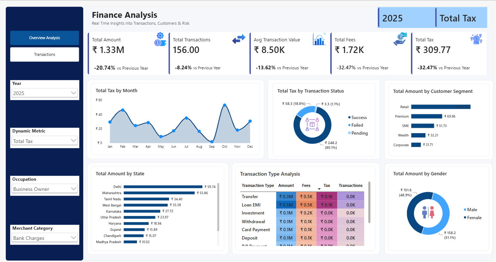
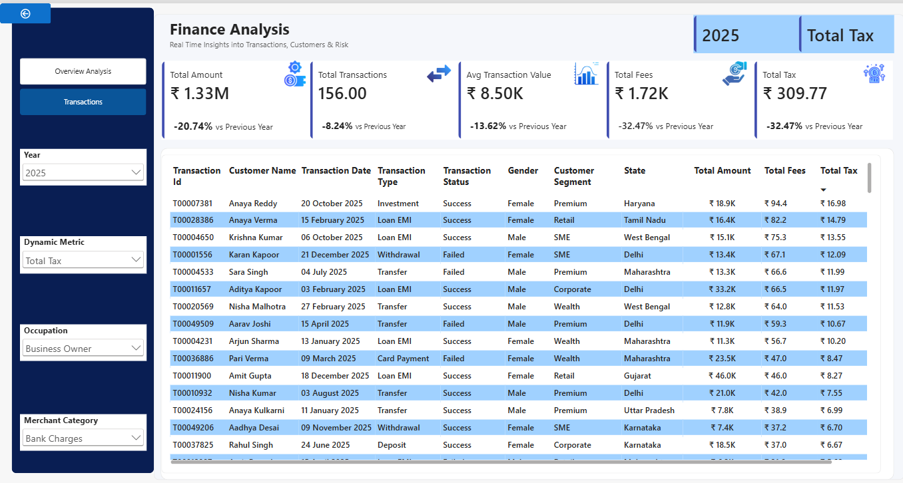

# Finance Transactions Analytics Dashboard

An interactive Power BI report that analyzes 50,000 INR banking transactions across 5,000 customers. It tracks transaction amount, fees and tax, compares each measure with the previous year, and lets users drill through from summary KPIs to customer-level detail.

**Tools:** Power BI, DAX, Power Query

---

## Dashboard Preview

### Overview Analysis


### Transactions (drill-through page)


---

## Dataset

| File | Rows | Columns | Description |
|---|---:|---:|---|
| `data/finance_transactions.csv` | 50,069 (raw) | 15 | Transaction ID, date, account, customer, type, channel, merchant category, amount, fee, tax, currency, status, fraud flag, risk score, reference number |
| `data/customers.csv` | 5,000 | 11 | Customer ID, name, gender, date of birth, city, state, occupation, customer segment, annual income, join date |

- Transaction period: 1 Jan 2023 to 30 Apr 2026
- Currency: INR
- 10 transaction types (for example Loan EMI, Transfer, Card Payment, Deposit) and 14 merchant categories
- Total transaction amount after cleaning: about ₹45.5 crore (₹455.5 million)

---

## Data Cleaning (Power Query)

Issues found in the raw files and how they were handled:

| Issue in raw data | Count | Treatment |
|---|---:|---|
| Duplicate `transaction_id` values | 69 | Removed, leaving 50,000 unique transactions |
| Missing `fee_amount` | 24 | Replaced with a fixed value of 14.52 |
| Negative `amount` | 9 | Converted to absolute values |
| Inconsistent currency text (`INR`, `inr`, `inR`) | 605 | Converted to uppercase |
| Extra spaces in `channel` | -- | Trimmed |
| Separate first and last name columns | 5,000 | Merged into `customer_name` |

Date columns are stored as `dd-mm-yyyy` text in the CSV files and typed as dates in Power Query.

---

## Data Model

- `finance_transactions` (fact table) -> `customers` (dimension), many-to-one on `customer_id`
- `Calendar Table`, created with DAX `CALENDAR()` from the first and last transaction dates
- `Dynamic Metric`, a selector table built with `NAMEOF()` so one visual can switch between Total Amount, Total Fees and Total Tax

---

## DAX Measures

The model has 23 measures. The base measures are:

| Measure | DAX |
|---|---|
| Total Amount | `SUM(finance_transactions[amount])` |
| Total Fees | `SUM(finance_transactions[fee_amount])` |
| Total Tax | `SUM(finance_transactions[tax_amount])` |
| Total Transactions | `DISTINCTCOUNT(finance_transactions[transaction_id])` |
| Avg Transaction Value | `AVERAGE(finance_transactions[amount])` |

Each base measure also has prior-year, year-over-year difference and year-over-year % versions, for example:

```DAX
PY Amount = CALCULATE([Total Amount], SAMEPERIODLASTYEAR('Calendar Table'[Date]))
YoY Amount = [Total Amount] - [PY Amount]
YoY % Amount = DIVIDE([YoY Amount], [PY Amount])
```

Title measures such as `Selected Year` and `Selected Dynamic Measure` use `SELECTEDVALUE()` to keep headings in sync with the slicers.

---

## Report Features

**Page 1: Overview Analysis**
- KPI cards: total amount, fees, tax, transaction count and average transaction value
- Bar charts by state and by customer segment
- Donut charts by gender and by transaction status
- Monthly area chart
- Slicers: year, occupation, merchant category and dynamic metric
- Custom visual interactions, so selected charts filter some visuals and not others

**Page 2: Transactions (drill-through)**
- Drill-through from the Overview KPIs to a customer-level table (customer name, segment, gender, state, amount, fees, tax and transaction date)
- Back button to return to the Overview page

---

## How to Open

1. Install [Power BI Desktop](https://powerbi.microsoft.com/desktop/) (free).
2. Open `report/Financial_Analytics.pbix`.
3. If Power BI asks for the data location, point it to the CSV files in the `data/` folder (Home > Transform data > Data source settings).

---

## Project Structure

```
finance-transactions-dashboard/
├── data/
│   ├── finance_transactions.csv
│   └── customers.csv
├── report/
│   └── Financial_Analytics.pbix
├── images/
│   ├── overview.png
│   └── transactions.png
└── README.md
```

---

## Author

**Prisha Shah**
M.Sc. Applied Data Science, SRM Institute of Science and Technology
[LinkedIn](https://www.linkedin.com/in/prisha-shah2245) | [GitHub](https://github.com/Prisha-22)
